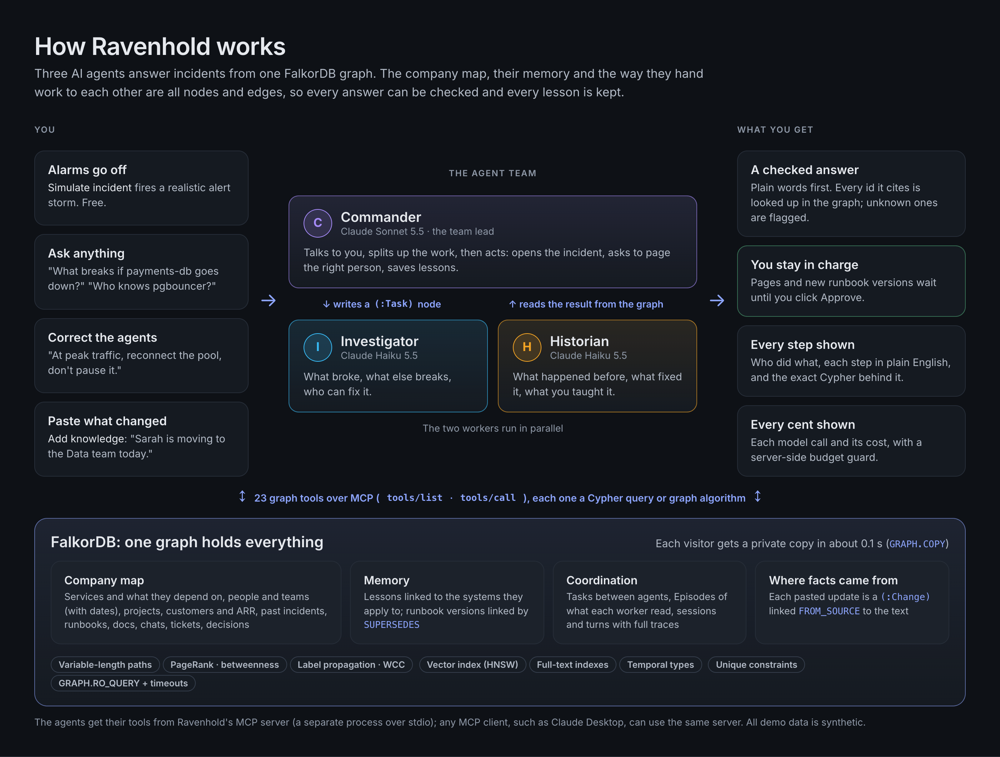
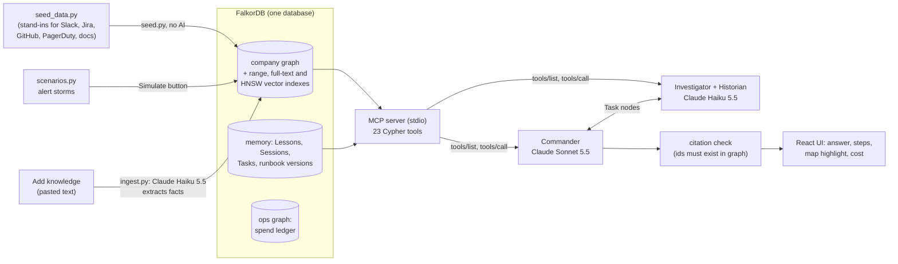
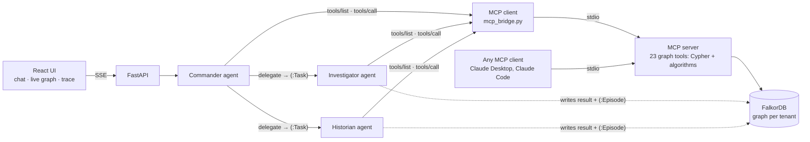
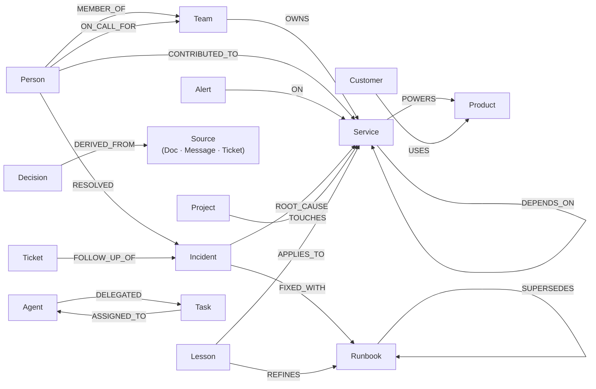

# Ravenhold

**Incident-response agents whose context, memory and coordination live in a FalkorDB graph.**

**Live demo:** https://ravenhold.onrender.com · **Demo video:** https://youtu.be/gQek1boZHDk · **Blog post:** https://yash-work.com/blog/ravenhold/

[](https://youtu.be/gQek1boZHDk)

When something breaks, three agents work out what else breaks, who actually knows the system, what fixed it last time
and what you taught them in earlier sessions. Then they act: they open the incident, page the right person and file
the follow-up. Every answer comes with the path through the graph that produced it.

> **Built for all three Graph Hacks tracks at once:** **Agents That Act on Connected Data**, **Agent Memory and Coordination** and **Company Brain**. One agent team, one FalkorDB graph. The demo company is **Ravenhold Pay**, a fictional payments business.

**Quick links:** [Graph map (nodes and relationships)](#graph-data-model) · [The Cypher behind each decision](#the-cypher-the-product-depends-on) · [Why a graph](#why-a-graph) · [Results](#results) · [Run it locally](#run-it-locally)

## Overview

**Ravenhold is a team of three AI agents that handles IT outages for a company.** To show it safely we invented the
company: **Ravenhold Pay**, a fictional payments business that shops and apps use to take card payments. In the demo,
**you play the engineer on call**: you set off a practice outage, ask questions, approve what the agents want to do,
and correct them.



**What the agents know.** They are **not trained on anything**. They are general AI models (Claude Sonnet 5.5 and
Claude Haiku 5.5) that know nothing about Ravenhold Pay on their own. Every fact they use is **looked up**, each time,
in one database (FalkorDB) that holds a map of the company:

| In the map | How many | A real example from it |
|---|---|---|
| Systems, and which depends on which | 27 | Checkout runs on the Payments API, which depends on PgBouncer |
| People and teams, with their history | 20 people in 6 teams | Sarah moved from Payments to Platform in June |
| Customers and what they pay | 8, $5.38M a year | Orbit Rides uses Checkout and pays $1.75M a year |
| Past outages | 10 | INC-142: PgBouncer ran out of connections in March, and Sarah fixed it |
| Documents, chats and tickets | 7 + 9 + 6 | A chat says "restart won't help"; ticket TKT-512 was promised and never done |
| Written-down fixes (runbooks) | 6 | RB-7: how to drain and resize the PgBouncer pool |
| Decisions | 4 | ADR-12: why ledger writes go through Kafka, linked to the chats and docs behind it |
| Projects | 5 | Pool hardening is overdue, and its key ticket sits with someone who never worked on PgBouncer |

All of it is hand-written and made up, in one file (`backend/ravenhold/seed_data.py`). Nothing comes from the
internet or a real company, and alarms only appear when you press **Simulate**.

**What the agents can do**
- **Look things up** with 23 tools, each one a database query: what breaks if a system fails, who really knows it,
  what happened last time, why it was built that way, who is working on what.
- **Act:** open an incident, ask you to approve paging someone, file a follow-up ticket, close the incident.
- **Remember:** when you correct them, the lesson is saved in the map, and a corrected fix becomes a new version once
  you approve it. That is the only way they "learn".
- **Keep the map current:** paste news into **Add knowledge** ("Sarah joins the Data team") and the map updates,
  with a link back to what you pasted.

**What happens when you ask a question**
1. The **Commander** (Claude Sonnet 5.5) reads your question.
2. For bigger questions it writes tasks for the **Investigator** and the **Historian** (Claude Haiku 5.5), who work in
   parallel and leave their results in the map.
3. Each agent picks the tools it needs from Ravenhold's MCP server; every tool runs a query against FalkorDB.
4. The Commander writes the answer and cites the ids it used, and the server checks that every cited id exists.
5. Anything that matters, like paging a person or changing a runbook, waits for your click.

The **Steps** panel describes each of these steps in one sentence, with the exact database query underneath.

**What it can't do:** answer anything outside Ravenhold Pay, see live systems, really call anyone, or learn anything
you didn't tell it.

**Where AI is used, and where it isn't**

| Done by AI (Claude) | Done by plain code and the database |
|---|---|
| Understanding your question, choosing which tools to use, writing the answer | All company data (a hand-written file), every graph query, the step-by-step explanations, the citation check, the cost tracking |
| Pulling facts out of text you paste into **Add knowledge** | The alarms (hand-written practice storms), the "similar wording" search (local word hashing, not an AI model) |

## Results

Measured on 2026-10-18 against this repository: FalkorDB 4.22.1 (Docker), Claude Sonnet 5.5 as the Commander and
Claude Haiku 5.5 as the workers, every graph tool call over MCP. Each agent run uses a fresh `GRAPH.COPY` of the demo
company, and answers are scored against **ground truth computed from the graph**, not against what the model says
about itself. Raw outputs and the exact commands are in [`docs/eval/`](docs/eval/).

**Agent accuracy** (real model calls)

| Track | Evaluation | Runs passed | Cited ids that exist |
|---|---|---|---|
| 🕵️ Act on connected data | Alert-storm triage, 3 storms × 3 runs: correct root cause / right person paged / unrelated alarm flagged | **9/9 · 9/9 · 9/9** | 100% |
| 🕵️ Act on connected data | Impact: every customer the outage reaches is named (8 of 8) | **2/2** | 36/36 |
| 🕵️ Act on connected data | Closed loop, one run per storm: right root cause / right person paged / noise flagged / **right fix proposed on the root service** (applying it clears exactly the alarms it explains) | **3/3 · 3/3 · 3/3 · 3/3** | 100% |
| 🕵️ Act on connected data | The 7 UI presets take the documented tool path and contain the expected facts | **7/7** | n/a |
| 🤖 Memory and coordination | Cross-session memory: a correction becomes a Lesson and a proposed runbook version; after approval, a **new** conversation uses it, cites RB-7-v2, says it remembered, and both worker handoffs complete (7 sub-checks) | **2/2** | 28/28 |
| 🧠 Company brain | Projects, experts and decision sources answered from the graph | **6/6** | 67/67 |
| 🧠 Company brain | Pasted updates applied exactly (target false before, true after, no extra changes; includes one message with no facts) | **9/9** | n/a |
| 🧠 Company brain | After "Sarah takes over TKT-512", the project risk is gone | **2/2** | 27/27 |

Median 26 s and about $0.05 per incident investigation (most of the time is the model, not the graph).

**Systems** (no model calls)

| Benchmark | Result |
|---|---|
| Deterministic tests (`pytest`) | **32/32** in about 15 s |
| Concurrency: 100 conversations at once across 5 private graphs | **1,600 graph operations in 3.0 s** (about 530/s), 0 failures, 0 duplicate ids, 0 cross-tenant leaks |
| Scale: generated company of 20,000 services (45k nodes, 196k relationships) | Every agent tool **under 1 s** (slowest: blast radius from deep infrastructure, 911 ms) |
| Web (Lighthouse, mobile, production build) | Performance 98 · Accessibility 100 · Best practices 100 · SEO 100 |

**Defects these suites found, all fixed and re-verified:** a check-then-create race that stored a lesson up to 6
times under concurrency; a connection pool that raised instead of waiting under load; MCP passing default arguments
that the direct path never sent; agents unable to say "remembered" because they didn't know their own session; impact
answers that named products instead of customers; and `find_experts` failing on a malformed date at scale.

**Limits:** samples are small (2 to 9 runs per agent check) and model output varies, so read these as "passed in every
run we made", not as precise accuracy rates. Agent evaluations ran locally on the same code and data as the live site.
All data is synthetic. Reproduce with `cd backend && uv run pytest -q`, `scripts/eval_agents.py --runs 3`,
`scripts/eval_tracks.py --runs 2`, `scripts/bench_concurrency.py` and `scripts/bench_scale.py --services 20000`.

## Built for all three tracks

Ravenhold is one project entered in all three tracks at once, not three separate demos. The same three agents and the
same FalkorDB graph cover every key focus of every track. Each row says where to see it in the live app and where it
lives in the code.

**🕵️ Agents That Act on Connected Data**: *the best agent that uses a graph to make decisions and take action*

| Key focus | What Ravenhold does | See it | Code |
|---|---|---|---|
| Multi-hop reasoning | Walks `DEPENDS_ON` up to 6 hops to products, customers and ARR; collapses a 13-alarm storm to one root cause and flags the unrelated alarm; follows a decision back to the chats and docs it came from | **Simulate an incident → Investigate**, then **Highlight on the map** | `tools.py`: `blast_radius`, `root_cause_candidates`, `correlate_alerts`, `trace_decisions` |
| Graph queries and algorithms as agent tools | 23 typed Cypher tools, including FalkorDB PageRank, betweenness, harmonic centrality, label propagation, WCC and `shortestPath`, plus hybrid graph + full-text + vector retrieval | Ask "Which services are our biggest single points of failure?"; open any step for its Cypher | `tools.py` `TOOLS` |
| Tool selection through MCP | The agents' tool catalogue **is** the MCP server's `tools/list`, and every step they pick runs with `tools/call` over stdio, in a separate MCP server process. The same server works in Claude Desktop or Claude Code | **Steps** says "tools via MCP"; **How it works → Under the hood** shows the live transport | `mcp_server.py --agents`, `mcp_bridge.py`, `tests/test_mcp.py` |
| Actions based on what the graph shows | **A closed loop: decide → act → verify.** It opens the incident, asks to page the person the graph shows fixed it before (not just whoever is on call), and **proposes the fix** (the latest approved runbook on the root-cause service). When a human approves, the fix is applied to the system state in the graph: exactly the alarms the root cause explains clear, the unrelated one keeps firing, and `check_recovery` verifies it from the graph, with time to mitigate | **Apply fix** card under the answer → "Fix applied and verified ✓", the map turns healthy | `declare_incident`, `page_person`, `propose_fix`, `check_recovery`, `create_ticket`, `resolve_incident` |
| Explainable results | One plain-English sentence per step (written by code, not an LLM), the exact Cypher, every cited id checked against the graph, the path through the map, models, tokens and cost | **Show how this was answered** under every answer | `explain.py`, `verify_citations`, `Transparency.tsx` |

**🤖 Agent Memory and Coordination**: *the best agents that remember across sessions and share what they know*

| Key focus | What Ravenhold does | See it | Code |
|---|---|---|---|
| Episodic, semantic and procedural memory | Episodic: sessions, the incidents they handled, and an `Episode` for every worker run with the nodes it read. Semantic: `Lesson`s linked to the systems they apply to. Procedural: runbook versions linked by `SUPERSEDES`, adopted only after a human approves | Teach a correction, open **Learned**, then start a new conversation | `record_lesson`, `get_runbook`, `recall_memory`, `complete_task` |
| Persistent conversation history | `Session` → `Turn` nodes, each answer stored with its full trace (steps, Cypher, costs) | **History**: reopen a conversation after a restart | `add_turn`, `history` in `agents.py` |
| Shared state and handoffs between agents | The Commander writes `Task` nodes; the Investigator and Historian run in parallel, read their task from the graph and write back the result and an `Episode`; the Commander reads the results with Cypher | **Steps → Who is doing what** | `create_task`, `complete_task`, `run_worker` |
| High-concurrency reads and writes | 100 conversations at once across 5 private graphs: 1,600 graph operations in 3.0 s, 0 failures, 0 duplicate ids, a lesson repeated by 20 conversations stored once and reinforced 19 times. The benchmark found and fixed two real race/pool bugs (see Evaluation) | `scripts/bench_concurrency.py` | atomic counters, single-query check-and-create, unique constraints, blocking connection pool (`db.py`) |
| Separate memory per user or tenant | A graph per workspace (`ravenhold`, `ravenhold-labs`) plus a private `GRAPH.COPY` for every visitor (about 0.1 s). The benchmark checks that no sandbox can see another's lessons | Every visitor gets their own copy | `api.py` sandboxes, `db.copy_graph` |

**🧠 Company Brain**: *the best agent that understands how a company works and gets work done*

| Key focus | What Ravenhold does | See it | Code |
|---|---|---|---|
| Knowledge from docs, tickets and chats in one graph | Postmortems, design docs, Slack messages and tickets are `:Source` nodes linked to the services, incidents, people and projects they are about, full-text indexed | **How it works → The data** (counted live) | `seed_data.py`, `seed.py` |
| People, teams, projects, documents and decisions connected | Teams `OWNS` services and projects; people `LEADS` / `WORKS_ON` projects; projects `TOUCHES` services, `IMPLEMENTS` decisions, are `DOCUMENTED_IN` docs, and tickets are `PART_OF` them | Ask "What is the Platform team working on, and is anything at risk?" | `project_overview` |
| Who owns what, and who knows what | Compares who `OWNS` a system with who `RESOLVED` incidents on it or `CONTRIBUTED_TO` it, and who is `ON_CALL_FOR` it; flags project tickets held by someone with no history on that system, and names who knows it | Ask "Who actually knows pgbouncer, and are they on call?" | `find_experts`, `project_overview` |
| Tracing decisions back to their source | `Decision -[:DERIVED_FROM]-> Doc / Message / Ticket`; projects that `IMPLEMENTS` a decision still marked *proposed* are flagged | Ask "Why do ledger writes go through Kafka?" | `trace_decisions` |
| Keeping knowledge current as things change | Paste a message: team moves (old membership closed with an end date, not deleted), on-call, ownership, dependencies, decisions, to-dos, project membership and status, ticket reassignment. Every change is a `(:Change)-[:FROM_SOURCE]->(:Source)` | **Add knowledge** | `ingest.py` |
| Answers with clear sources | Every `[id]` in an answer is looked up in the graph, and unknown ones are flagged | The green "facts checked" badge and **Sources cited** | `verify_citations` |
| Gets work done | Opens incidents, requests pages, files follow-ups, updates the map from what you tell it, and says who can unblock an at-risk project | Investigate, then approve | Commander action tools |

## Transparency: what's real, what's synthetic, and how it works

**In short:** every record in the demo is **synthetic**. It was hand-written in one file (`backend/ravenhold/seed_data.py`)
with the help of an AI coding assistant, and it is loaded by `seed.py` with no AI calls. There are **no live
connectors**. Slack, Jira, GitHub, PagerDuty and docs are each a list in that file, and alerts come from three
hand-written storms in `scenarios.py`. **FalkorDB is the only database.** It holds the company graph, the vector
index, the full-text indexes, the agents' memory and coordination, and the spend ledger. There are **three agents**:
the Commander runs on Claude Sonnet 5.5, and the Investigator and Historian run on Claude Haiku 5.5. **Embeddings are
local word hashing** (`embed.py`), not an AI model. The only text an AI turns into graph links is what a user pastes
into **Add knowledge**. The same facts appear in the app under **How it works → Under the hood**, counted live from
the graph (`GET /api/about`). Under every answer, **Show how this was answered** shows the tools, path, sources,
models, tokens and time.



**Data provenance** (counts are from the template graph; the app's Guide recounts them live)

| Dataset | File (`backend/ravenhold/…`) | Records | How it was made | How its links are created |
|---|---|---|---|---|
| Systems and dependencies | `seed_data.py` `SERVICES`, `DEPENDS_ON` | 27 services, 41 dependencies | hand-written | explicit pairs in the file |
| People, teams, on call | `PEOPLE`, `TEAMS`, `ON_CALL` | 20 people, 6 teams, 6 rotations | hand-written (common English names) | explicit; `MEMBER_OF` has `from`/`to` dates, 3 team moves |
| Customers and products | `CUSTOMERS`, `PRODUCTS` | 8 customers ($5.38M ARR), 5 products | hand-written, invented names and round ARR figures | explicit `USES`, `POWERS` lists |
| Code history | `CONTRIBUTED_TO` | 32 person→service links | hand-written commit counts | explicit, `commits` property |
| Past incidents | `INCIDENTS` | 10 | hand-written; INC-142 (PgBouncer, fixed by Sarah) is planted | explicit `ROOT_CAUSE`, `AFFECTED`, `IMPACTED`, `RESOLVED`, `FIXED_WITH` |
| Documents, decisions | `DOCS`, `DECISIONS` | 7 docs, 4 decisions | hand-written; ADR-12 traces to PM-142, DD-31, MSG-5, MSG-6 | explicit `AUTHORED`, `DOCUMENTS`, `AFFECTS`, `DERIVED_FROM`, `MADE` |
| Chats | `MESSAGES` | 9 | hand-written; includes "don't restart the database" | explicit `POSTED`, `MENTIONS` |
| To-dos | `TICKETS` | 6 (3 still open, TKT-512 planted) | hand-written | explicit `FOLLOW_UP_OF`, `ABOUT`, `ASSIGNED_TO` |
| Projects | `PROJECTS` | 5 (owner team, lead, members, systems, tickets, decisions, docs) | hand-written; PRJ-POOL is overdue and its key ticket sits with someone who never touched pgbouncer (planted) | explicit `OWNS`, `LEADS`, `WORKS_ON`, `TOUCHES`, `IMPLEMENTS`, `DOCUMENTED_IN`, `FOLLOWS_UP`, `PART_OF` |
| Runbooks | `RUNBOOKS` | 6 | hand-written | explicit `FOR`; later versions `SUPERSEDES` older ones |
| Alert storms | `scenarios.py` | 13, 9 and 8 alerts | hand-written; each storm has one unrelated "noise" alert | `(:Alert)-[:ON]->(:Service)` when you press Simulate |
| Pasted knowledge | `ingest.py` | whatever you paste | Claude Haiku 5.5 extracts typed facts | LLM-extracted; each fact is a `(:Change)` linked `FROM_SOURCE` to the pasted `(:Source)`, ids must already exist, no confidence score |

Names: people have common English names, and customer names are invented. **No trademark or real-person search was
run.** "Northwind" is also the name of Microsoft's well-known sample database.

**Stack**

| Component | Technology | Version | Config |
|---|---|---|---|
| Graph, vector and full-text store | FalkorDB (FalkorDB Cloud free tier live; Docker locally) | 4.22.0 on FalkorDB Cloud, 4.22.1 locally (`falkordb/falkordb:latest`) | `docker-compose.yml`, `FALKORDB_*` env in `render.yaml` |
| Python client | `falkordb` | 1.8.0 | `backend/pyproject.toml`, `uv.lock` |
| Agents | Anthropic Messages API with a hand-written tool loop, no agent framework | `anthropic` 1.15.0; Claude Sonnet 5.5 + Claude Haiku 5.5 | `RAVENHOLD_MODEL`, `RAVENHOLD_WORKER_MODEL` |
| Embeddings | local signed feature hashing, 256 dimensions | n/a | `backend/ravenhold/embed.py` |
| API | FastAPI + SSE | 0.143.3 / sse-starlette 3.5.0 | `backend/ravenhold/api.py` |
| MCP server | `mcp` | 2.3.0 | `backend/ravenhold/mcp_server.py` |
| UI | React, Vite, react-force-graph-2d | 19.2.8, 8.3.0, 1.29.2 | `frontend/package.json` |
| Hosting | Render free plan (Docker), Singapore | n/a | `Dockerfile`, `render.yaml` |

<details>
<summary><b>Indexing details and rebuild commands</b></summary>

- **Range indexes and unique constraints:** an index on `id` for every main label (18 labels), with
  `create_node_unique_constraint`. These are in `seed.py`, `INDEXES` and `UNIQUE_IDS`.
- **Full-text indexes:** `Incident(title, summary)`, `Source(title, text)` (docs, chats, tickets, pasted text) and
  `Lesson(text)`.
- **Vector index:** `CREATE VECTOR INDEX FOR (i:Incident) ON (i.embedding) OPTIONS {dimension: 256, similarityFunction: 'cosine'}`.
  This is FalkorDB's HNSW index with default parameters, queried top 6.
  - **What is embedded:** each incident's `title + summary`, one vector per incident, with no chunking. The "chunk" is
    the node itself, so its id, date and links come with every hit.
  - **Not embedded:** docs, chats and lessons. They use full-text search instead.
- **When indexing runs:**
  - at seed time; the API seeds any missing workspace on startup
  - incrementally after that: `declare_incident` and `resolve_incident` write the incident's vector, and FalkorDB
    updates the full-text and range indexes on every write
- **Rebuild everything:** `cd backend && uv run python -m ravenhold.seed`. This drops and recreates both workspaces
  with all indexes and constraints.
- **Check the indexes:** `CALL db.indexes()`.
</details>

<details>
<summary><b>Answering pipeline, with a worked trace</b></summary>

1. **No separate intent classifier.** The Commander reads the question together with a catalog of service and people ids
   (`catalog()` in `agents.py`, capped at 150). It then picks tools by following its instructions (`COMMANDER_SYSTEM`
   in `backend/ravenhold/agents.py`).
2. **Entity linking:** the model chooses ids from the catalog. Every tool checks them against the graph with an indexed
   lookup and returns close matches for a wrong id.
3. **Graph traversal** (Cypher in `tools.py`):
   - blast radius: `DEPENDS_ON*1..6` upstream
   - root cause: `*1..4` downstream
   - similar incidents: within `*1..2`
   - `shortestPath` up to 6 hops
   - `graph_query`: read-only (`GRAPH.RO_QUERY`), 100 rows, 3 s timeout
4. **Retrieval:** `similar_incidents` adds up three scores: graph proximity (2 for the same service, 1 within 2 hops),
   full-text score (capped at 5) and vector similarity × 3. It keeps the top 5. There is no re-ranking model.
5. **Delegation:** for bigger questions the Commander creates `Task` nodes. The Investigator and Historian run in
   parallel and report back through them.
6. **Synthesis:** the Commander writes the answer with `[id]` citations. The server checks that every cited id
   exists in the graph and flags any that don't. The plain-English step summaries come from code (`explain.py`), not
   from an AI.

**Worked trace: "Why do ledger writes go through Kafka?"** (a real run)
- The Commander called `trace_decisions(ledger-service)` and `trace_decisions(kafka)`. Each runs
  `MATCH (d:Decision)-[:AFFECTS]->(:Service {id: $id}) OPTIONAL MATCH (p:Person)-[:MADE]->(d) OPTIONAL MATCH (d)-[:DERIVED_FROM]->(src:Source) …`.
- That returned ADR-12, made by Helen Carter and derived from PM-142, DD-31, MSG-5 and MSG-6.
- The answer cited 13 ids, and all 13 were verified in the graph. It took 6.4 s and cost $0.025.
</details>

**Do the preset questions take the path we expect?** We ran `backend/scripts/preset_paths.py`, which puts each of
the 7 UI presets on a fresh graph copy with no alerts firing. Every tool call in these runs goes over MCP.

| Preset | Expected path | Actual path (tools, in order) | Matches |
|---|---|---|---|
| Live incident | correlate → root cause → experts → similar incidents → runbook → page | `correlate_alerts` → `situation_report` → `declare_incident` → `delegate` → `root_cause_candidates`, `blast_radius`, `similar_incidents`, `find_experts`, `open_follow_ups`, `recall_memory`, `get_runbook` → `page_person` | Yes, with one caveat (below) |
| Impact | `blast_radius(payments-db)` → customers + ARR | `delegate` → `blast_radius` → `find_experts` → `open_follow_ups` ($5.4M at risk) | Yes |
| Expertise | `find_experts(pgbouncer)` + on-call | `delegate` → `find_experts(pgbouncer)` → `graph_query` (team on call) | Yes: Sarah knows it; James is on call |
| Projects | `project_overview` → members, tickets, risks | `project_overview` (one call) | Yes: PRJ-POOL is overdue, TKT-512 sits with Marcus, Sarah knows pgbouncer; ADR-19 still proposed |
| Decisions | `trace_decisions` → ADR-12 → sources | `trace_decisions(ledger-service)`, `trace_decisions(kafka)` | Yes |
| Risk | graph centrality, not LLM judgment | `critical_services` (FalkorDB PageRank, betweenness, harmonic centrality, label propagation) | Yes |
| Vague report | `situation_report` maps "$1M" to exposure, alerts and risky follow-ups | `situation_report(money_usd=1000000)` → `correlate_alerts` | Yes: with no alerts firing, it says so and asks one question |

**Mismatches we found and fixed.** In the first run, **Risk** and **Decisions** did not use their dedicated tools:
the Commander wrote its own Cypher instead. For Risk, that meant the "single points of failure" were a fan-in count,
not graph centrality. Both tools are now given to the Commander directly, with an instruction to prefer them over
`graph_query`. After that change, all 6 presets match, and the Projects preset added later matches too (7/7).

**The caveat that remains.** The *text-only* Live incident question, asked with no alerts firing, ranks `payments-db`
above `pgbouncer`, because the graph shows payments-db caused 2 past incidents and pgbouncer 1. The answer names both,
and it pages Thomas, the payments-db expert. When the alert storm is simulated, `correlate_alerts` pins the root to
pgbouncer and the right person, Sarah, is paged in 9/9 evaluation runs (see Evaluation).

<details>
<summary><b>Known limitations, and what changes with real connectors</b></summary>

**Limitations**
- **No real paging.** An approved page is a `(:Page)` node; nobody is called.
- **No live data.**
- **The graph is small:** 116 nodes in the template. The scale test goes to 20k services, with every query
  under 1 s.
- **Embeddings match shared wording, not meaning.** Any embedding model can replace `embed.py` without changing a
  query.
- **Demo limits:** one shared credit budget, shown live to every visitor (when it runs out the agents pause), and no login or role-based access.
- **Memory lasts until you reset.** Each visitor's private copy keeps lessons across sessions until they press **⋯ → Reset my copy**,
  and copies unused for 24 h are deleted. The shared template is never changed by visitors.

**With real Slack, Jira and GitHub connectors**
- **Auth:** OAuth apps per workspace, with tokens kept in a secret store rather than `.env`.
- **Permissions:** keep each source's access control. Store the ACL on each `Source` node and filter tool queries by
  the asking user.
- **PII:** redact personal data before it reaches the graph or the model, and keep raw text out of embeddings.
- **Sync:** use webhooks (Slack events, Jira and GitHub webhooks) for near-real-time `ingest()` calls, plus a nightly
  backfill. The existing `(:Change)-[:FROM_SOURCE]->(:Source)` provenance and the MEMBER_OF date history already
  support this.
- **Data quality:** add confidence scores to extracted facts, and send low-confidence ones to human review, the same
  way runbook changes are approved today.
</details>

## How to evaluate (5 minutes)

1. **Live demo: https://ravenhold.onrender.com** You get your own private copy of the company graph, so nothing you
   do affects anyone else. Click **How it works** for a 2-minute illustrated story.
2. **Try it, free:** press **Simulate an incident**. Thirteen alerts fire across ten systems at no cost.
   Press **Investigate** (about $0.04) and open **Steps**: under **Who is doing what** you can watch the Commander hand
   tasks to the other agents through the graph ([how that works](#see-who-is-doing-what)). When they decide to page
   someone, you approve it.
3. **Teach it:** reply with a correction ("at peak use RECONNECT, not PAUSE"). Open **Learned** to see the new runbook
   version, then start a new conversation (**⋯ → New conversation**) and simulate again. The new conversation uses the improved fix.
4. **Check its work:** under any answer, open **Show how this was answered** to see the things it recognised, every
   tool with its input and output, the path through the map (one click highlights it), the cited sources with a
   grounded or uncertain flag, and the model, tokens and time. **Steps** shows the same work in plain words and
   as Cypher. **Cost** lists every AI call.
5. **Keep it current:** click **Add knowledge** and paste something like "Sarah is moving to the Data team today;
   James takes over Payments on-call". The map updates, shows exactly what changed, and links each change to the text
   you pasted. Then ask the agents "who is on call for Payments now?"
6. **Ask about the company, not just incidents:** "What is the Platform team working on, and is anything at risk?"
   It finds that pool hardening is overdue because TKT-512 sits with someone who never touched pgbouncer, and names
   who knows it. Paste "Sarah takes over TKT-512 and joins the PgBouncer pool hardening project" into **Add
   knowledge** and ask again: the risk is gone.
7. **Without an API key:** run `cd backend && uv run pytest -q` (32 tests, no AI calls), or connect the MCP
   server to your own assistant.

### What makes it different

- **It investigates before it asks.** A vague report such as *"we're losing a million dollars"* triggers a graph-wide
  situation report: firing alerts, active incidents, which products and customers are large enough to account for the
  money, and risky open follow-ups. The agent answers with ranked hypotheses and at most one question.
- **It turns an alert storm into one root cause.** *Simulate incident* fires 7–12 alerts across a service chain. The
  agent walks `DEPENDS_ON` to find the one alerting service that explains all the others. For example: 12 alerts on 9
  services trace back to pgbouncer.
- **Its runbooks rewrite themselves.** When a human corrects a procedure, the agent writes a new runbook version
  (`RB-7-v2`) that `SUPERSEDES` the old one, linked to the lesson and session it came from. Every later session follows
  the new version.
- **A human approves every action that matters.** Pages wait as `awaiting_approval` until someone clicks
  **Approve**. Runbook changes learned from corrections wait as `proposed`, and the agents keep using the current
  version until a human approves the new one.
- **Every step is explained in one readable sentence**, written from the step's real result (for example "2 promised fixes
  never got finished: TKT-512…"), with the Cypher underneath for engineers.
- **Every answer keeps its trace.** Steps, Cypher and costs are saved with the conversation in the graph, so a session
  reopened later shows exactly how each answer was reached.
- **It checks its own citations.** Every `[id]` an answer cites is looked up in the graph, and unknown ids are
  flagged. Grounding doesn't rely on the prompt alone.
- **Every visitor gets a private sandbox.** On first visit, FalkorDB `GRAPH.COPY` clones the company graph (about
  0.1 s). Incidents, lessons and history stay in the visitor's own graph, so nobody can poison anyone else's memory.
- **Its agents choose their tools through MCP.** The tool list each agent sees comes from the MCP server's
  `tools/list`, and every step runs with `tools/call` over stdio. The bridge fills in only the workspace and session,
  so the model never picks whose graph it touches.
- **It knows who is working on what.** Projects link teams, leads, members, systems, tickets, decisions and docs.
  `project_overview` works out risks from the graph: an overdue project, a ticket held by someone with no history on
  that system (and who does know it), a decision still only proposed, an incident on something the project touches.
- **It keeps the company brain current.** Paste a chat message or document (or just say it in the chat). Claude
  Haiku extracts the facts, using only ids already in the graph, and each one is applied with Cypher and recorded as a
  `(:Change)-[:FROM_SOURCE]->(:Source)`. Team moves close the old `MEMBER_OF` edge with an end date instead of deleting
  it, so history is kept. Extraction costs about $0.0003 per message.
- **Everything is visible.** Each answer shows the agent handoffs, every graph step and its Cypher, clickable next
  steps, and what it cost. A usage panel shows which model each agent runs on and where every cent goes.

### See who is doing what

While the agents work, the **Steps** tab (on a phone: **Steps & details**) shows a card for every job the Commander
hands out, and how that job is going. Here is a real one, from the question *"Who actually knows pgbouncer, and are
they on call?"*:

> **WHO IS DOING WHAT** · tasks passed between agents through the graph
>
> **Investigator** · `DONE`
> Service: pgbouncer. Run find_experts on pgbouncer (and on its top dependencies/dependents if relevant), preferring
> people who resolved past incidents caused by pgbouncer. Report who actually knows it (commits, past incidents
> resolved, current team) and who is on call for the owning team, and whether the experts are on call.
>
> **HOW IT FOUND THE ANSWER** · 3 steps · 11 queries · click to see

**Why it helps if you're not technical.** It reads like a team lead's to-do list, so the AI is no longer a black box.

- **You see the plan, not just the answer.** Each card says which agent got which job, in the exact words the
  Commander used.
- **You can tell whether it asked the right question.** In this card the Commander told the Investigator to look for
  people who have *fixed* pgbouncer before, not just whoever happens to be on call. That instruction is why the answer
  names the person who fixed it last time. If the instruction were wrong, you would see it here and could correct it.
- **You can see progress.** The status moves from *todo* to *running* to *done*. A slow answer is visibly still
  working, and a task that fails says *failed* instead of quietly disappearing.
- **You can check the work.** Under the cards, every step is one plain-English sentence ("Finding who knows this
  system best"). Click one to light up the systems and people it looked at on the map.

**Why it helps if you're an engineer.** The card isn't a log line. It's a node in FalkorDB, so the handoff can be
queried, audited and replayed.

- `delegate` writes `(:Agent {id:'commander'})-[:DELEGATED]->(:Task {instructions, status:'todo'})-[:ASSIGNED_TO]->(:Agent)`,
  linked `IN_SESSION` to the conversation.
- The Investigator and Historian run **in parallel threads**. Each one reads its task from the graph, sets `status` to
  `running`, then writes `t.result` with `done` or `failed`, plus an `(:Episode)` that `TOUCHED` every node it read.
- The Commander reads the results back **with Cypher, not from Python memory**. If a worker's model call fails, only
  that Task is marked `failed` and the run continues.
- **Prompt debugging gets easier.** The exact instruction each worker received is stored, so a bad answer can be traced
  to a vague task, a wrong tool choice or a bad tool result.
- **Runs can be audited later.** The UI cards are built from the same `task_created` / `task_status` events. Those
  events are saved with the conversation, so reopening a session in **History** shows the handoffs again. Or ask the
  graph directly:

```cypher
// Who handed what to whom in one conversation, and how much of the graph each worker read
MATCH (t:Task)-[:IN_SESSION]->(:Session {id: $sid})
MATCH (commander:Agent)-[:DELEGATED]->(t)-[:ASSIGNED_TO]->(worker:Agent)
OPTIONAL MATCH (e:Episode)-[:FOR_TASK]->(t)
OPTIONAL MATCH (e)-[:TOUCHED]->(n)
RETURN commander.id AS from, worker.id AS to, t.status AS status,
       count(DISTINCT n) AS nodes_read, t.instructions AS task
```

On a recorded incident run, this returns two parallel tasks: the Investigator read 44 nodes and the Historian 28.

---

## Why a graph

The questions asked during an incident are about connections, not about single records:

| Question | Graph work |
|---|---|
| What breaks if `payments-db` goes down? | Variable-length `DEPENDS_ON` traversal → `POWERS` → `USES` to reach customers and ARR |
| Who should we page? | People who `RESOLVED` incidents on the service or `CONTRIBUTED_TO` it, compared with the team that `OWNS` it and who is `ON_CALL_FOR` that team |
| What fixed this last time? | Incidents within 2 dependency hops, `FIXED_WITH` runbooks, `Lesson`s that `REFINES` a runbook |
| Why is it built like this? | `Decision -[:DERIVED_FROM]-> Doc / Message / Ticket` |
| What's the single point of failure? | PageRank, betweenness and WCC over `DEPENDS_ON` |
| 12 alerts just fired. What's the cause? | Alerting services with no alerting dependency beneath them are root causes; everything that `DEPENDS_ON` them is explained |
| Which runbook is current? | Follow `SUPERSEDES` to the newest version and the correction that produced it |

**Without FalkorDB the product does nothing.** Every agent tool is a Cypher query or graph algorithm, agent memory is
nodes and edges, and agents hand off work to each other only through `Task` nodes.

## The demo story (synthetic data)

`Ravenhold Pay` is a fictional payments company with 27 services, 20 people, 6 teams, 8 customers, 10 past incidents,
postmortems, Slack threads, tickets and architecture decisions. All of it is invented (Rule 6). Some facts in it are
only visible if you follow the connections:

- The official owner of `payments-db` is the Payments team, whose on-call engineer (**Marcus**) has **0 commits and
  0 incidents** on it.
- The person who fixed it last time (**Sarah**, INC-142) **moved to the Platform team** in June. The fact that she
  still knows it is held by `RESOLVED` and `CONTRIBUTED_TO` edges; the time-stamped `MEMBER_OF` edges say she left the team.
- The INC-142 postmortem says *"restarting payments-db did NOT help"*. Its follow-up **TKT-512 is still open**.
- ADR-12 (async ledger writes) traces back to a Slack proposal by Sarah and the INC-142 postmortem.
- The **PgBouncer pool hardening** project (PRJ-POOL) is past its due date. Its open ticket TKT-512 is assigned to
  Marcus, who asked in Slack what it was for (MSG-8); Sarah, who knows pgbouncer best, isn't on the project.


### What the names and codes mean

Incident tools use short codes for every record. You will see them in answers, and the app explains each one: hover
over or tap a code, or open "What the names and codes in this answer mean" under any answer.

| Code | What it is | Example in the demo |
|---|---|---|
| `INC-` | An outage record: what broke, when, and who fixed it | `INC-142`, the March checkout outage |
| `RB-` | A runbook: the written, step-by-step fix (`-v2` = a newer version a human approved) | `RB-7`, drain and resize the PgBouncer pool |
| `TKT-` | A to-do ticket | `TKT-512`, make the pool limits permanent |
| `ADR-` | A design decision on record | `ADR-12`, ledger writes go through Kafka |
| `PM-` / `DD-` | A postmortem (the write-up after an outage) / a design document | `PM-142`, `DD-31` |
| `MSG-` | A chat message (Slack) | `MSG-5`, Sarah's proposal |
| `PRJ-` | A project | `PRJ-POOL`, PgBouncer pool hardening |
| lower-case | A system or a person | `pgbouncer`, `payments-db`, `sarah` |

The systems with technical names, in everyday words: **PgBouncer** is the connection pool that shares a small number
of connections to the payments database among every system that needs one. **Kafka** is the message queue (systems
leave messages there for others to pick up later). **Payments DB** is the database of every payment. Every system has
a one-line everyday description in the graph (`Service.plain`), shown on the map and on every code in an answer.

## Architecture



- **Commander** talks to the human. It delegates, declares incidents, pages people, files tickets, resolves incidents
  and records lessons.
- **Investigator** works out the blast radius, ranks root-cause candidates, finds experts, checks open follow-ups and
  runs the graph algorithms.
- **Historian** finds similar incidents, runbooks and their refinements, and recalls memory from earlier sessions.
- **Tools come from MCP.** At startup the API launches `python -m ravenhold.mcp_server --agents` and connects to it
  over stdio. Each agent's tool list is the server's `tools/list`, filtered to its role, and every call is a
  `tools/call`. One connection serves all agents; calls from parallel workers run concurrently (the server runs each
  tool in its own thread). `delegate` is the one tool that stays in-process, because it starts the worker agents. If
  the MCP server can't start, tools run in-process and every step records which way it went (`via` in the trace).
- `delegate` creates `(:Task)-[:ASSIGNED_TO]->(:Agent)` nodes. Workers run **in parallel threads**, read their task
  from the graph and write `t.result` plus an `(:Episode)` back. The Commander reads the results **from the graph**.
- Each tenant has its own graph (`ravenhold` and `ravenhold-labs`), using FalkorDB's multi-graph support. Memory, sessions and tasks
  are kept per tenant.
- Every tool returns `{result, cypher[], subgraph}`. The UI streams these and highlights the exact nodes and edges
  behind each answer, coloured by agent.

**Models are pluggable** ([`llm.py`](backend/ravenhold/llm.py)). The demo uses Claude Sonnet 5.5 as the Commander
and Claude Haiku 5.5 as the cheaper, faster workers. The same agents also run on any OpenAI-compatible endpoint. They
were tested on open-weight `openai/gpt-oss-120b` via Groq, and also work with OpenRouter, Together, Ollama and vLLM.
The graph does most of the reasoning work, so the agent stays useful even on an open model. The agent loop runs parallel tool calls concurrently. It returns
malformed tool arguments and unknown tool names to the model as errors so it can correct itself. If a worker's model
call fails, the worker's `Task` node is marked `failed` and the run continues.

## Graph data model

The main node types and how they connect. Every agent decision is a walk along these relationships: the full list is
below, and [the Cypher the product depends on](#the-cypher-the-product-depends-on) shows the queries.



| The agent decides… | …by walking |
|---|---|
| Which alarm is the real cause | `Alert-ON->Service-DEPENDS_ON*->Service`: an alarming system with nothing alarming beneath it |
| Who is affected | `Service<-DEPENDS_ON*1..6-Service-POWERS->Product<-USES-Customer` |
| Who to call | `RESOLVED` and `CONTRIBUTED_TO` compared with `OWNS` and `ON_CALL_FOR` |
| Which fix to propose | `Incident-FIXED_WITH->Runbook`, then `SUPERSEDES` to the newest approved version |
| What it remembers | `Lesson-APPLIES_TO->Service` and `Lesson-REFINES->Runbook` from earlier sessions |

```
(:Person)-[:MEMBER_OF {from: date, to: date | null}]->(:Team)-[:OWNS]->(:Service)-[:DEPENDS_ON]->(:Service)
(:Person)-[:ON_CALL_FOR]->(:Team)
(:Person)-[:CONTRIBUTED_TO {commits, last_at}]->(:Service)
(:Service)-[:POWERS]->(:Product)<-[:USES]-(:Customer {arr, sla})

(:Incident)-[:ROOT_CAUSE]->(:Service)      (:Incident)-[:AFFECTED]->(:Service)
(:Person)-[:RESOLVED]->(:Incident)-[:FIXED_WITH]->(:Runbook)-[:FOR]->(:Service)
(:Incident)-[:IMPACTED]->(:Customer)

(:Source:Doc)-[:DOCUMENTS]->(:Incident)   (:Source:Doc)-[:ABOUT]->(:Service)   (:Person)-[:AUTHORED]->(:Doc)
(:Source:Message)-[:MENTIONS]->(:Service|:Incident)                         (:Person)-[:POSTED]->(:Message)
(:Source:Ticket)-[:FOLLOW_UP_OF]->(:Incident)  (:Ticket)-[:ABOUT]->(:Service)  (:Ticket)-[:ASSIGNED_TO]->(:Person)
(:Decision)-[:DERIVED_FROM]->(:Source)  (:Decision)-[:AFFECTS]->(:Service)  (:Person)-[:MADE]->(:Decision)
(:Team)-[:OWNS]->(:Project {status, goal, due: date})<-[:LEADS|WORKS_ON]-(:Person)   (:Ticket)-[:PART_OF]->(:Project)
(:Project)-[:TOUCHES]->(:Service)  (:Project)-[:IMPLEMENTS]->(:Decision)  (:Project)-[:DOCUMENTED_IN]->(:Doc)
(:Project)-[:FOLLOWS_UP]->(:Incident)
```

**Agent memory and coordination** (stored in the same tenant graph):

```
(:Session)-[:HAS_TURN]->(:Turn {role, text, seq})            persistent conversation history
(:Session)-[:PREVIOUS]->(:Session)                           session chain
(:Session)-[:HANDLED]->(:Incident)                           episodic: what this session dealt with
(:Lesson {kind, text, source, reinforced})-[:APPLIES_TO]->(:Service)      semantic memory
(:Lesson)-[:REFINES]->(:Runbook)                             procedural memory
(:Lesson)-[:LEARNED_IN]->(:Session)   (:Lesson)-[:ABOUT_INCIDENT]->(:Incident)
(:Agent)-[:DELEGATED]->(:Task {status, instructions, result})-[:ASSIGNED_TO]->(:Agent)     shared state / handoff
(:Agent)-[:PERFORMED]->(:Episode)-[:FOR_TASK]->(:Task)    (:Episode)-[:TOUCHED]->(any node it read)
(:Page)-[:TO]->(:Person)  (:Page)-[:FOR]->(:Incident)                    actions taken
(:Lesson)-[:PRODUCED]->(:Runbook {version})-[:SUPERSEDES]->(:Runbook)     procedural memory that updates itself
(:Alert {severity, status, metric})-[:ON]->(:Service)                      live signals
(:Change {kind, summary})-[:FROM_SOURCE]->(:Source)  (:Change)-[:CHANGED]->(any node)   knowledge updates with provenance
```

Spend is tracked per model and per agent role as `(:Spend {model, role, usd, calls, tokens_in, tokens_out})` nodes in a
separate `ops` graph. That makes the budget guard survive restarts.

Indexes and constraints: range indexes and **unique constraints** on `id` for every main label, full-text indexes on
`Incident(title, summary)`, `Source(title, text)` and `Lesson(text)`, and a **vector index** on `Incident.embedding`
(256 dimensions, cosine). Dates are native FalkorDB temporal types (`date()`, `localdatetime()`); `MEMBER_OF.to IS NULL`
means "current team".

## FalkorDB features used

| FalkorDB feature | Where Ravenhold uses it |
|---|---|
| Cypher: variable-length paths, `OPTIONAL MATCH`, `MERGE`, `UNWIND`, `shortestPath` | Every agent tool: blast radius (6 hops), root cause (4 hops down), experts, follow-ups, decisions |
| **`algo.pageRank`, `algo.betweenness`, `algo.HarmonicCentrality`** | Most depended-on services, chokepoints, services with the widest reach |
| **`algo.labelPropagation`** (community detection) | Failure domains: groups of services that tend to fail together |
| **`algo.WCC`** | Isolated services nothing depends on |
| **Vector index** (`CREATE VECTOR INDEX`, `vecf32`, `db.idx.vector.queryNodes`) | Similar incidents by meaning, combined with graph proximity and full-text (hybrid retrieval) |
| **Full-text indexes** (`db.idx.fulltext.*`) | Incidents, documents, chats, tickets, lessons |
| **Range indexes + unique constraints** (`GRAPH.CONSTRAINT`) | The database itself guarantees ids are unique; checked by a test |
| **Temporal types** (`date()`, `localdatetime()`, `duration()`) | Team history, "moved teams 4 months ago", recent activity, repeat offenders in the last 6 months |
| **Multi-graph** (one graph per tenant) | Ravenhold Pay and Ravenhold Labs are isolated graphs |
| **`GRAPH.COPY`** | A private copy of the company graph for every visitor in about 0.1 s |
| **`GRAPH.RO_QUERY` + per-query `TIMEOUT`** | Read-only tools; model-written Cypher is stopped after 3 seconds |
| Atomic `MERGE … SET` | Race-free incident and ticket numbers; spend ledger |
| FalkorDB Cloud + Docker | Live deployment (Cloud) and local development (Docker) |

The `RESULTSET_SIZE` default (10,000 rows) is why every tool looks up only the ids it needs. The 20,000-service
benchmark below caught one place that didn't.

## The Cypher the product depends on

All of these live in [`backend/ravenhold/tools.py`](backend/ravenhold/tools.py).

**Blast radius.** This is a multi-hop traversal that reaches customers and revenue:

```cypher
MATCH p = (d:Service)-[:DEPENDS_ON*1..6]->(:Service {id: $id})
RETURN d.id, d.tier, min(length(p)) AS hops ORDER BY hops

MATCH (s:Service {id: $id})
OPTIONAL MATCH (d:Service)-[:DEPENDS_ON*1..6]->(s)
WITH s, collect(DISTINCT d) AS deps WITH deps + [s] AS hit
UNWIND hit AS x
MATCH (x)-[:POWERS]->(prod:Product)
OPTIONAL MATCH (c:Customer)-[:USES]->(prod)
RETURN prod.name, collect(DISTINCT x.id) AS via, collect(DISTINCT c.id) AS customers
```

**Who actually knows this system.** This compares hands-on experience with the official ownership:

```cypher
MATCH (s:Service {id: $id}), (p:Person)
OPTIONAL MATCH (p)-[c:CONTRIBUTED_TO]->(s)
OPTIONAL MATCH (p)-[:RESOLVED]->(i:Incident)-[:ROOT_CAUSE|AFFECTED]->(s)
OPTIONAL MATCH (p)-[:AUTHORED]->(d:Doc)-[:ABOUT]->(s)
WITH p, coalesce(max(c.commits), 0) AS commits, collect(DISTINCT i.id) AS incidents, collect(DISTINCT d.id) AS docs
WHERE commits > 0 OR size(incidents) > 0 OR size(docs) > 0
OPTIONAL MATCH (p)-[m:MEMBER_OF]->(team:Team) WHERE m.to = ''
RETURN p.name, team.name AS current_team, incidents, commits,
       size(incidents) * 30 + commits / 5 + size(docs) * 10 AS score
ORDER BY score DESC
```

**Root-cause candidates.** This walks *down* the dependency graph and ranks by past failures and PageRank:

```cypher
MATCH p = (:Service {id: $id})-[:DEPENDS_ON*1..4]->(d:Service)
WITH d, min(length(p)) AS hops
OPTIONAL MATCH (i:Incident)-[:ROOT_CAUSE]->(d)
RETURN d.id, d.status, hops, count(DISTINCT i) AS past_root_causes
```

**Similar incidents.** This combines graph proximity with full-text search:

```cypher
MATCH (s:Service {id: $id})
OPTIONAL MATCH (s)-[:DEPENDS_ON*1..2]-(n:Service)
WITH s, collect(DISTINCT n) AS ns WITH ns + [s] AS hood
UNWIND hood AS x
MATCH (i:Incident)-[:ROOT_CAUSE|AFFECTED]->(x)
RETURN i.id, max(CASE WHEN x.id = $id THEN 2 ELSE 1 END) AS proximity

CALL db.idx.fulltext.queryNodes('Incident', $terms) YIELD node, score RETURN node.id, score
```

**Decision provenance:**

```cypher
MATCH (d:Decision)-[:AFFECTS]->(:Service {id: $id})
OPTIONAL MATCH (p:Person)-[:MADE]->(d)
OPTIONAL MATCH (d)-[:DERIVED_FROM]->(src:Source)
OPTIONAL MATCH (author:Person)-[:AUTHORED|POSTED]->(src)
RETURN d.title, p.name, collect({id: src.id, kind: src.kind, by: author.name})
```

**Memory recall.** This returns lessons from earlier sessions for a service and its neighbours:

```cypher
MATCH (s:Service) WHERE s.id IN $ids
OPTIONAL MATCH (s)-[:DEPENDS_ON]-(n:Service)
WITH collect(DISTINCT s) + collect(DISTINCT n) AS hood
UNWIND hood AS x
MATCH (l:Lesson)-[:APPLIES_TO]->(x)
OPTIONAL MATCH (l)-[:LEARNED_IN]->(sess:Session)
OPTIONAL MATCH (l)-[:REFINES]->(rb:Runbook)
RETURN DISTINCT l.text, l.kind, sess.id, rb.id ORDER BY l.reinforced DESC, l.created_at DESC
```

**Graph algorithms as agent tools:**

```cypher
CALL algo.pageRank('Service', 'DEPENDS_ON') YIELD node, score
CALL algo.betweenness({nodeLabels: ['Service'], relationshipTypes: ['DEPENDS_ON']}) YIELD node, score
CALL algo.WCC({nodeLabels: ['Service'], relationshipTypes: ['DEPENDS_ON']}) YIELD node, componentId
MATCH (a {id: $a}), (b {id: $b}) RETURN shortestPath((a)-[*..6]->(b))
```

**Alert-storm correlation.** An alerting service with no alerting dependency beneath it is a root candidate. Every
alerting service that depends on it is explained by it:

```cypher
UNWIND $hot AS cid
MATCH (c:Service {id: cid})
OPTIONAL MATCH (d:Service)-[:DEPENDS_ON*1..6]->(c) WHERE d.id IN $hot
WITH c, collect(DISTINCT d.id) AS explains
OPTIONAL MATCH (c)-[:DEPENDS_ON*1..6]->(u:Service) WHERE u.id IN $hot
RETURN c.id AS service, explains, count(DISTINCT u) AS alerting_below   // alerting_below = 0 → root candidate
```

**Current runbook version.** Procedural memory updates over time:

```cypher
MATCH (b:Runbook {id: $id})
OPTIONAL MATCH p = (n:Runbook)-[:SUPERSEDES*1..10]->(b)
RETURN coalesce(n.id, b.id) AS current ORDER BY length(p) DESC LIMIT 1
```

**Agent handoff through the graph:**

```cypher
MATCH (c:Agent {id: 'commander'}), (w:Agent {id: $agent}), (s:Session {id: $sid})
CREATE (t:Task {id: $tid, instructions: $ins, status: 'todo'})
CREATE (c)-[:DELEGATED]->(t), (t)-[:ASSIGNED_TO]->(w), (t)-[:IN_SESSION]->(s)
```

## Evaluation

**Deterministic graph tests:** `uv run pytest -q` runs 32 tests in about 15 seconds with no AI cost. Each runs on a
throwaway `GRAPH.COPY` of the template:

| What is checked | Result |
|---|---|
| Each of the 3 alert storms collapses to the correct single root cause, and its one unrelated alert is flagged as noise | 3 / 3 |
| The expert for payments-db is Sarah (fixed it, moved teams), not the on-call engineer (0 commits, 0 incidents) | ✅ |
| Blast radius reaches products, customers and ARR; open follow-up TKT-512 is found from INC-142 | ✅ |
| ADR-12 traces back to the Slack proposal and the postmortem | ✅ |
| A correction creates RB-7-v2, then v3; `get_runbook("RB-7")` returns the latest | ✅ |
| A lesson from one session is recalled in another, through a neighbouring service, marked as coming from an earlier conversation | ✅ |
| Duplicate lessons are reinforced, not duplicated; 25 concurrent incidents get unique numbers | ✅ |
| Wrong ids get a correction (product → services, typo → nearest id); `graph_query` cannot write | ✅ |
| Citation check separates real ids from invented ones | ✅ |
| Paging waits for human approval; a decision can't be flipped afterwards | ✅ |
| Ingested facts: a team move keeps history, records provenance, and changes what the agents see (on-call, blast radius, decisions) | ✅ |
| A correction only *proposes* a runbook version; agents use it after a human approves it | ✅ |
| Model-written Cypher is stopped after 3 seconds, so it can't hog the shared database | ✅ |
| Every agent tool is listed over MCP without the workspace/session fields; calls over MCP return the full trace, hit only the visitor's own graph, and optional arguments behave exactly like a direct call | ✅ |
| Projects show who works on what, and the planted risks (ticket held by someone with no history, overdue, decision still proposed) | ✅ |
| Pasted updates reassign a ticket and change project membership and due date, each with provenance; the risk disappears | ✅ |

**Agent evaluation:** `uv run python scripts/eval_agents.py --runs 3` runs 3 alert-storm scenarios × 3 runs with
the real agents. Each run uses a fresh copy of the graph and is scored against ground truth computed from the graph:
the real root service, the top-2 experts on it, and the planted noise alert.

| Commander | Runs | Root cause correct | Right person paged | Noise alert called out | Cited ids valid | Latency median (max) | Cost per answer |
|---|---|---|---|---|---|---|---|
| Claude Sonnet 5.5, effort `low` (workers: Haiku 5.5), tools over MCP, re-run 2026-10-18 | 9 | **9/9** | **9/9** | **9/9** | **100%** | 26 s (30 s) | $0.052 |

The same agents also ran end to end on open-weight `gpt-oss-120b` (via Groq).

**Accuracy per track:** `uv run python scripts/eval_tracks.py --runs 2` asks the real agents track-specific questions,
each on a fresh graph copy, and scores the answers against ground truth computed from the graph. Results from
2026-10-18, all tool calls over MCP:

| Track | Check (ground truth) | Runs passed | Cited ids valid |
|---|---|---|---|
| 🕵️ Act on connected data | Alert storm → right root, right person paged, noise alert called out (`eval_agents.py`) | **9/9** | 100% |
| 🕵️ Act on connected data | "If kafka goes down, which customers feel it first?" names every customer `blast_radius` returns (8) | **2/2** after the fix below | 36/36 |
| 🤖 Memory and coordination | Session A: a correction saves a Lesson and proposes RB-7-v2; a human approves. Session B (new): uses RECONNECT, cites RB-7-v2, says "remembered from an earlier session", and both worker Tasks finish | **2/2** after the fix below (7/7 sub-checks) | 28/28 |
| 🧠 Company brain | Projects: names TKT-512, Marcus holding it, Sarah knowing pgbouncer, ADR-19 pending, the overdue date | **2/2** | 32/32 |
| 🧠 Company brain | Experts: names the top `find_experts` person and the on-call engineer | **2/2** | 11/11 |
| 🧠 Company brain | Decisions: ADR-12 and all 4 sources it is `DERIVED_FROM` | **2/2** | 24/24 |
| 🧠 Company brain | 9 pasted updates (ticket reassignment, project membership, due date, on-call, team move, ownership, dependency, ticket status, and one message with no facts): target state false before, true after, no extra changes | **9/9** | n/a |
| 🧠 Company brain | Projects question again after "Sarah takes over TKT-512": the risk is gone | **2/2** | 27/27 |

**What the first run caught, and the fixes.** (1) One of two impact answers described the affected products without
naming the customers (0 of 8). The answer format now asks for every affected customer by name with its ARR; both
re-runs named all 8. (2) Both memory runs used the corrected runbook in the new conversation but never said
"remembered from an earlier session". The cause was real: the agents don't know their own session id, so they couldn't
tell an earlier lesson from one said a minute ago. `recall_memory` now marks each lesson `earlier_session: true/false`
itself (covered by a test), and the Historian passes that on; both re-runs passed every sub-check. A smaller re-check
after both fixes passed again (3/3 alert storms on all measures, 4/4 company-brain questions, 9/9 updates); its raw
output wasn't saved, so it isn't counted above. Raw outputs for everything counted are in [`docs/eval/`](docs/eval/).

**Scale benchmark:** `uv run python scripts/bench_scale.py --services 20000` builds a synthetic company (layered
service graph, people, teams, incidents, products, customers), fires a 57-alert storm and times the agents' tools:

| Query (median, re-run 2026-10-18) | 5,000 services (11k nodes, 49k relationships) | 20,000 services (45k nodes, 196k relationships) |
|---|---|---|
| Alert storm → root cause | 39 ms | 93 ms |
| Blast radius, most-depended-on infrastructure service | 683 ms | 911 ms |
| Root-cause candidates (4 hops down) | 58 ms | 100 ms |
| Who knows this system | 191 ms | 600 ms |
| Similar past incidents | 14 ms | 10 ms |
| PageRank + betweenness + WCC | 147 ms | 557 ms |

The benchmark caught three bugs that the demo data hid, all now fixed: the id check loaded every service on each
call, the id catalog in the prompt listed every service, and `find_experts` failed on a malformed team end date (the
benchmark's own generated data had one; the tool now skips a date it can't read, and a test covers it). The graph work stays well under a second; nearly
all of an answer's time is spent in the LLM.

**Concurrency benchmark:** `uv run python scripts/bench_concurrency.py` runs 100 conversations at the same moment,
spread over 5 private visitor graphs (20 each). Each conversation does what an incident run does, through the same
code and the same MCP connection the agents use: open a session, declare an incident, hand two tasks to the workers,
run both workers in parallel (six graph tools), write their results and Episodes, save one lesson that every
conversation repeats plus one of its own, and store the turns. No AI calls, so it is free and repeatable.

Result (local Docker FalkorDB, Apple Silicon laptop): **1,600 graph operations (600 reads, 1,000 writes) in 3.0 s,
about 530 operations a second, 0 failures.** Latency is with all 100 conversations competing at once:

| Operation | Count | p50 | p95 |
|---|---|---|---|
| Task handoff (write) | 200 | 1 ms | 9 ms |
| Worker result + Episode (write) | 200 | 62 ms | 134 ms |
| `record_lesson` (write) | 200 | 81–107 ms | 144–159 ms |
| `declare_incident` (write, atomic counter) | 100 | 173 ms | 757 ms |
| Graph tools over MCP (read, 6 kinds) | 600 | 396–1,287 ms | 621–1,453 ms |

| Check, in every sandbox | Expected | Got |
|---|---|---|
| Duplicate ids of any kind | 0 | **0** |
| Incidents, each with a unique number | 20 | **20** |
| Tasks finished, each with an Episode | 40 | **40** |
| The lesson all 20 conversations saved | 1 node, reinforced 19× | **1, 19×** |
| Other sandboxes' lessons visible | 0 | **0** |

**The benchmark caught two real bugs, both fixed.** (1) `record_lesson` checked for a duplicate and then created the
lesson in a separate query, so two agents saving the same lesson at the same moment both created it (up to 6 copies).
The check and the create are now one write query, which FalkorDB runs one at a time per graph. (2) redis-py's default
connection pool *raises* once 100 connections are busy, so heavy concurrent use failed with "Too many connections".
`db.py` now uses a blocking pool that waits briefly for a free connection.

## Design decisions and limitations

- **Our own memory schema instead of Graphiti, Cognee or Mem0.** Every memory read and write is a Cypher query we can
  show and explain: lessons, versioned runbooks, sessions and tasks are plain nodes and edges. Those frameworks also
  need an OpenAI key for extraction and embeddings, and we wanted one model provider. Graphiti's temporal entity
  extraction is the natural next step.
- **Local embeddings for the vector index.** Anthropic has no embeddings API, so incidents are embedded with a small,
  deterministic feature-hashing model (`embed.py`, 256 dimensions, no API key). It catches shared vocabulary
  ("pool connections queueing" finds INC-142), not deep meaning. The index and queries are model-agnostic, so a real
  embedding model is a drop-in swap.
- **Task-level MCP tools instead of raw Cypher.** FalkorDB's official MCP server exposes generic query tools. Ours
  exposes the 23 tools an incident agent actually needs (blast radius, find experts, correlate alerts…).
- **Ingestion is paste-based, not connector-based.** Ravenhold Pay starts from synthetic data (Rule 6). New knowledge
  comes in through **Add knowledge** or the chat, as pasted text or documents. Live Slack, Jira and GitHub connectors
  would feed the same `ingest()` function and aren't built. The graph also updates itself from agent work: incidents,
  pages, tickets, lessons and runbook versions.
- **Actions are recorded, not sent.** Paging writes a `(:Page)` node; a production build would call PagerDuty or Slack.

## Tools

| Tool | Kind | Used by |
|---|---|---|
| `situation_report`, `correlate_alerts` | read / triage | Commander and Investigator |
| `blast_radius`, `root_cause_candidates`, `find_experts`, `open_follow_ups`, `critical_services`, `shortest_connection` | read / algorithms | Investigator |
| `similar_incidents`, `get_runbook`, `recall_memory`, `search_knowledge` | read / memory | Historian |
| `trace_decisions`, `graph_query` (read-only Cypher) | read | Investigator and Historian |
| `project_overview` | read / company brain | Commander and Historian |
| `update_knowledge` | **write** (from a stated fact, with provenance) | Commander |
| `declare_incident`, `page_person`, `propose_fix`, `create_ticket`, `resolve_incident`, `record_lesson` | **write / act** (pages and fixes wait for a human) | Commander |
| `check_recovery` | read / verify after a fix | Commander |

All 23 graph tools are served over **MCP**. Ravenhold's own agents use them that way (`tools/list` + `tools/call`,
see Architecture), and any other MCP client can pick and call them too:

```bash
claude mcp add ravenhold -- uv --directory "$(pwd)/backend" run python -m ravenhold.mcp_server
```

## Run it locally

Requirements: Docker, Python 3.12 with [uv](https://docs.astral.sh/uv/), Node 20+ and an Anthropic API key (or a key
for any OpenAI-compatible provider of a tool-calling model).

```bash
# 1. FalkorDB (Browser UI on http://localhost:3000, Redis protocol on 6380)
docker compose up -d

# 2. Backend
cd backend
cp .env.example .env            # set ANTHROPIC_API_KEY + LLM_PROVIDER=anthropic, or the LLM_* open-model settings
uv sync
uv run python -m ravenhold.seed          # loads the ravenhold + ravenhold-labs tenant graphs
uv run uvicorn ravenhold.api:app --port 8000

# 3. Frontend (new terminal)
cd frontend
npm install
npm run dev                     # http://localhost:5173
```

Smoke-test the tools without an LLM: `cd backend && PYTHONPATH=. uv run python scripts/smoke_tools.py`.
Run an agent from the CLI: `cd backend && uv run python -m ravenhold.agents "What breaks if payments-db goes down?"`.
End-to-end test of memory across two sessions (about $0.10): `cd backend && uv run python scripts/e2e_test.py`.

### Deploy

The `Dockerfile` builds the UI and serves it together with the API from one FastAPI process. `render.yaml` deploys
that image to Render. Point `FALKORDB_URL` at a FalkorDB Cloud instance; the API seeds the demo graphs on first boot.
The public deployment has three safeguards:

- **A hard spend guard**, `RAVENHOLD_BUDGET_USD`. Spend is tracked per model in an `ops` graph in FalkorDB, so the
  total survives restarts.
- **An `ADMIN_TOKEN`** that is required to reset the demo data.

## Project layout

```
docker-compose.yml          FalkorDB
backend/ravenhold/
  seed_data.py              the synthetic company
  seed.py                   loads it (UNWIND batches, indexes, full-text indexes)
  tools.py                  23 graph tools: Cypher, algorithms, memory, actions, projects
  agents.py                 Commander / Investigator / Historian, coordinating through the graph
  mcp_server.py             the tools over MCP (for any client, and --agents mode for Ravenhold's own agents)
  mcp_bridge.py             the agents' MCP client: tools/list for their catalogue, tools/call for every step
  ingest.py                 Add knowledge: pasted text -> typed facts -> graph changes with provenance
  llm.py                    pluggable LLM backend (OpenAI-compatible or Anthropic)
  api.py                    FastAPI + SSE stream of agent events, per-visitor sandboxes
backend/scripts/            eval_agents, preset_paths, bench_scale, bench_concurrency
frontend/src/               React UI: chat, live graph highlight, trace, memory, sessions
```

## Use of AI assistants

In line with Rule 11: this project was built with the help of an AI coding assistant, **Claude Opus 5.5** (used through
Claude Code). It helped scaffold code, write Cypher queries and draft documentation. I designed the product, the graph
model and the demo scenario, directed every feature, and reviewed, ran and tested every query and agent flow myself.

This is separate from the models the product itself runs on (Claude Sonnet 5.5 and Claude Haiku 5.5, or any
OpenAI-compatible model), which are described under [Architecture](#architecture).

## License

[MIT](LICENSE) © 2026 Yash
